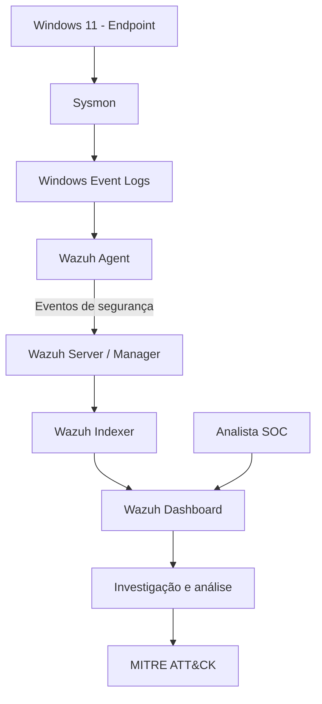

# Arquitetura do Laboratório SOC

## 1. Visão geral

O projeto consiste na implementação de um laboratório de monitoramento e detecção de eventos de segurança utilizando Wazuh, Sysmon e Windows 11.

O objetivo é construir um ambiente centralizado para coleta, análise e investigação de eventos, simulando atividades comuns de um ambiente SOC (Security Operations Center).

A infraestrutura será composta por um servidor central hospedado em uma VPS Linux e um endpoint Windows monitorado.

## 2. Componentes da arquitetura

| Componente | Tecnologia | Responsabilidade |
|---|---|---|
| Servidor central | Ubuntu Server LTS | Hospedar a infraestrutura do laboratório |
| SIEM | Wazuh Server/Manager | Processar eventos e aplicar regras de detecção |
| Armazenamento | Wazuh Indexer | Armazenar e indexar eventos e alertas |
| Interface | Wazuh Dashboard | Consultar, visualizar e investigar eventos |
| Endpoint | Windows 11 | Sistema monitorado |
| Telemetria | Sysmon | Registrar atividades detalhadas do Windows |
| Coleta | Wazuh Agent | Coletar e encaminhar eventos ao servidor |
| Framework | MITRE ATT&CK | Classificar comportamentos e técnicas de ataque |
| Documentação | GitHub | Registrar configurações, regras e investigações |

## 3. Infraestrutura

### Servidor central — VPS

- Provedor: Hostinger
- Sistema operacional: Ubuntu Server LTS
- Processamento: 2 vCPU
- Memória: 8 GB RAM
- Armazenamento: 100 GB NVMe
- Implantação: Wazuh All-in-One

Os componentes centrais do Wazuh serão instalados na mesma VPS.

### Endpoint monitorado — Windows

- Sistema operacional: Windows 11
- Sysmon: coleta de telemetria do sistema
- Wazuh Agent: encaminhamento dos eventos ao servidor central

## 4. Fluxo de dados

1. O Sysmon registra atividades relevantes do Windows.
2. Os eventos são armazenados nos canais de eventos do Windows.
3. O Wazuh Agent coleta os eventos configurados.
4. O Agent encaminha os dados ao Wazuh Server.
5. O Wazuh Server analisa os eventos e aplica regras de detecção.
6. O Wazuh Indexer armazena os dados.
7. O Wazuh Dashboard permite visualizar alertas e realizar investigações.

## 5. Representação da arquitetura

## 6. Segurança da infraestrutura

Antes da implantação do Wazuh, foram realizadas medidas de hardening na VPS:

- Autenticação SSH por chave Ed25519.
- Desabilitação do login SSH direto do root.
- Desabilitação da autenticação SSH por senha.
- Criação de usuário administrativo dedicado.
- Utilização de sudo e princípio do menor privilégio.
- Configuração do UFW e firewall do provedor.
- Instalação e configuração do Fail2ban.
- Atualizações automáticas de segurança.
- Autenticação de dois fatores na conta do provedor.
- Criação de snapshot inicial e planejamento de backups periódicos.

As portas de comunicação serão liberadas conforme a necessidade de cada componente, evitando exposição desnecessária de serviços.

## 7. Objetivos técnicos

- Centralizar eventos de segurança de endpoints.
- Monitorar atividades de autenticação e execução de processos.
- Identificar comportamentos suspeitos.
- Analisar e correlacionar eventos.
- Criar e ajustar regras de detecção.
- Investigar alertas e documentar evidências.
- Relacionar comportamentos observados às técnicas MITRE ATT&CK.

## 8. Escopo das investigações

Serão documentadas três investigações controladas, contendo:

- Contexto e objetivo.
- Evidências coletadas.
- Análise dos eventos.
- Hipótese investigativa.
- Classificação de severidade.
- Técnica MITRE ATT&CK relacionada, quando aplicável.
- Conclusão e ações recomendadas.

## 9. Estado da implementação

**Concluído:**
- Preparação da VPS.
- Hardening inicial do Ubuntu Server.
- Configuração de acesso administrativo e firewall.
- Preparação da estrutura de documentação.

**Pendente:**
- Instalação do Wazuh All-in-One.
- Instalação e configuração do Sysmon.
- Instalação do Wazuh Agent.
- Integração do Windows com o servidor.
- Investigações e regras de detecção.

## 10. Tecnologias

Ubuntu Server · Wazuh · Sysmon · Windows 11 · SSH · UFW · Fail2ban · MITRE ATT&CK · GitHub
